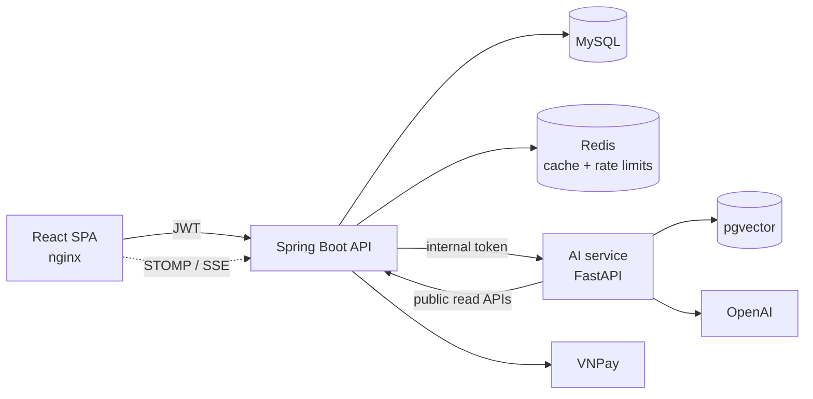

# Booking Clinic

[](https://github.com/khoazocute/booking-clinic-system/actions/workflows/ci.yml)
[](https://github.com/khoazocute/booking-clinic-system/actions/workflows/cd.yml)

A clinic appointment platform with an **AI booking assistant**. Patients describe their symptoms, get a suggested
specialty, see real doctors and free slots, and confirm a booking. Payment is through VNPay, and a member of staff
takes over when the assistant can't help.

**Spring Boot 4 · Java 21 · React 18 · Python FastAPI · OpenAI · MySQL · pgvector · Redis · Docker Compose**

**Live demo: https://3-106-10-9.sslip.io**

- Register a patient account to book a slot.
- Doctors and schedules are fictional, and free slots are refreshed every night.
- The public demo runs the assistant in its free fallback mode (specialty suggestion and emergency rules), with no
  OpenAI key.

---

## Engineering highlights

### 1. No double booking, verified under concurrency
Two patients pressing "Book" on the same slot at the same moment is a *read-then-write* race. Booking runs in one
transaction that **locks the slot row** (`SELECT … FOR UPDATE`). A concurrent request waits for that transaction to
commit, then sees the slot as `BOOKED` and gets **HTTP 409**. A patient also cannot hold two visits at overlapping
times, even with different doctors. Deleting a slot takes the same lock: a slot that holds a booking returns 409,
and a slot with past visits is closed rather than deleted, so the history is kept.

| 50 patients book one slot at the same instant | Result |
|---|---|
| With the row lock, MySQL 8 (Testcontainers) | **1 booked, 49 × 409** in 319 ms, exactly one appointment in the database |
| Same test with the lock removed | **10 patients got the same slot** (the test fails, as it should) |
| End to end over HTTP on the Docker stack, 20 accounts | 1 × 201, 19 × 409 |

The test ([`BookingConcurrencyTestBase`](Backend_API/booking-clinic/src/test/java/com/example/booking_clinic/booking/BookingConcurrencyTestBase.java))
runs on H2 and on **MySQL 8 via Testcontainers in CI**. An unpaid booking holds the slot for 10 minutes, then a
scheduler releases it. A paid booking is never auto-cancelled.

### 2. AI assistant: agentic RAG with guardrails ([details](AI_Service/README.md))
- **The agent picks its tools:** retrieval over clinic rules, specialty triage, live doctors and slots from the
  backend, and a booking *proposal*. **The AI never writes data.** The booking happens only when the patient clicks
  confirm, through the normal booking API with the patient's own JWT.
- **Hybrid retrieval:** pgvector (HNSW) plus BM25, fused with Reciprocal Rank Fusion. Indexing is incremental by
  content hash.
- **Safety outside the model:** emergency red flags are caught by rules *before* the LLM, which answers with a fixed
  "call 115" message. Personal data is redacted before anything is sent to OpenAI. A dosage guard runs on the output,
  and citations the model invents are dropped.
- **Streaming:** text is released one *checked sentence* at a time, so unfiltered tokens never reach the patient.
- **Measured, with dev/test splits:**

  | What | Result (test split) |
  |---|---|
  | Specialty triage, BM25 + symptom profiles | **91.4% Top-1**, 0% false answers (baseline keyword router: 40%) |
  | Emergency detection | 100% recall, 0% false alarms |
  | Knowledge retrieval, hybrid (local e5 embeddings) | **Recall@5 97.5%**, MRR 0.88 over 40 questions |
  | Context cost with RAG vs whole knowledge base in the prompt | **about 19× fewer tokens per LLM call** |

  The datasets were written by the same author as the system, so treat these numbers as an upper bound. A reranker
  was evaluated and **kept off**: it gave no gain on the test split and added 1–2.5 s of latency.

### 3. LLMOps dashboard
Every assistant turn records the answer path (agent / streaming / fallback), tools called, tokens, estimated cost,
latency, guardrail outcomes and the patient's 👍/👎. The admin dashboard shows satisfaction, p95 latency, cost per
turn, fallback and handoff rates, and a per-conversation trace. Costs are capped per patient per day and across the
system; when the system cap is reached, the assistant switches to a free keyword fallback instead of failing.

### 4. Human handoff and agent assist
The assistant can **offer** a member of staff, but never claims to have contacted one. The patient chooses whether to
share the AI conversation. Staff answer from a realtime inbox (STOMP over WebSocket, with polling as a fallback). They
can start from an **AI draft reply** grounded in clinic rules, with citations. The draft is never sent automatically,
and the share of replies that used a draft is measured.

### 5. Payments and security
- **VNPay is signed and verified on the server:** HMAC-SHA512, the amount taken from the database, and an IPN
  endpoint. Recording is idempotent. A client can no longer mark a payment as "paid".
- **No secrets in the repository:** a weak or missing `JWT_SECRET` stops the backend from starting. There is no
  default admin account. The database and Redis listen on loopback only. WebSocket origins are allow-listed. Routes
  are guarded by role in the UI as well as on the API.

---

## Architecture



| Service | Responsibility |
|---|---|
| `Frontend_ReactJs` | Patient, doctor and admin UIs; assistant widget; admin AI dashboard and support inbox |
| `Backend_API/booking-clinic` | Auth, booking, payments, notifications, conversations and telemetry; gateway to the AI service with fallback |
| `AI_Service` | Agent, retrieval, triage, guardrails, staff assist, evaluation harnesses. It has no published port and is reachable only from the backend |

## Features by role
- **Patient:** search doctors and specialties, book and pay (VNPay, cash, bank transfer), cancel with refund rules,
  medical records and prescriptions, reviews, notifications, the AI assistant, and live support.
- **Doctor:** schedules, appointments, medical records, prescriptions, reviews.
- **Admin:** users, doctors (licence verification), specialties, medicines and stock, appointments, payments, the
  support inbox, and the AI quality dashboard.

---

## Run locally

Requires Docker Desktop.

```bash
git clone https://github.com/khoazocute/booking-clinic-system.git
cd booking-clinic-system
cp .env.example .env        # then fill in the values below
docker compose up -d --build
```

Minimum `.env`:

```env
JWT_SECRET=<openssl rand -hex 32>
AI_INTERNAL_TOKEN=<openssl rand -hex 32>
ADMIN_EMAIL=admin@example.com      # first admin, created only on an empty database
ADMIN_PASSWORD=<at least 12 characters>
OPENAI_API_KEY=                     # optional: without it the assistant runs in free fallback mode
```

- App: http://localhost:5173 · API health: http://127.0.0.1:8082/api/v1/health
- Memory: the whole stack uses about 1 GB of RAM when idle, measured with `docker stats` (backend about 460 MB,
  MySQL about 370 MB, AI service about 75 MB).
- VNPay sandbox: set `VNPAY_TMN_CODE` and `VNPAY_HASH_SECRET`.
- Reminder emails: set `MAIL_USERNAME` and `MAIL_PASSWORD`. Without them, reminders are in-app only.
- All options are listed in [`.env.example`](.env.example).

## Tests

| Suite | Command | Notes |
|---|---|---|
| Backend | `cd Backend_API/booking-clinic && ./mvnw test` | The MySQL concurrency test runs when Docker is available |
| AI service | `cd AI_Service && python -m pytest` | Fake models only: **tests never call OpenAI** |
| Offline evals | `python -m eval.run_eval --router all-offline` · `python -m eval.retrieval_eval --retriever bm25` | Free; paid evals require `--allow-paid-api` |
| Frontend | `cd Frontend_ReactJs && npm run build` | |

## CI/CD

- **CI** ([`ci.yml`](.github/workflows/ci.yml)) runs on every push. It runs all of the tests above with real MySQL
  (Testcontainers) and a real pgvector, then builds the frontend and validates the compose file.
- **CD** ([`cd.yml`](.github/workflows/cd.yml)) runs after CI is green on `main`.
  - It builds multi-arch (amd64 and arm64) images and publishes them to GitHub Container Registry, tagged with the commit.
  - It deploys them to the server over SSH (`compose pull` and `up -d`), then runs a health check.
  - The running tag is pinned on the server, so rolling back means switching to the previous tag.
- The production stack ([`docker-compose.prod.yml`](docker-compose.prod.yml)) pulls images and builds nothing on the
  server. Caddy provides automatic HTTPS and is the only exposed service. Setup is in
  [`deploy/README.md`](deploy/README.md).

## Limitations and next steps
- The answer quality of the full chat agent is scored by an LLM-as-judge harness that is written but not yet run,
  because it needs paid API calls.
- The evaluation sets are small and were written by the same author. The next step is an independent question set.
- The live demo runs on a single AWS EC2 instance (t4g.small, ARM) with Docker Compose. There is no staging
  environment and no zero-downtime deploys yet.
